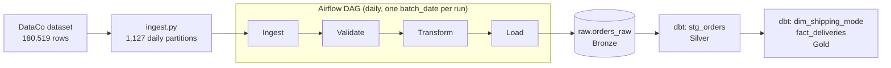

# Supply Chain Data Pipeline

A batch ETL and analytics pipeline for supply chain order data. Raw order records are ingested as daily partitions, orchestrated with **Apache Airflow**, landed in a **PostgreSQL** warehouse, and modeled with **dbt** into analytics-ready tables, following a bronze / silver / gold architecture with automated data quality tests.

The pipeline is built on top of my earlier late-delivery-risk work on the DataCo supply chain dataset (see [Related work](#related-work)), turning a one-off notebook analysis into a repeatable, tested data engineering workflow.

## Highlights

- **180,519** order line items processed from the DataCo dataset into **1,127 daily partitions**
- **Airflow** DAG running `ingest -> validate -> transform -> load`, scheduled daily with one `batch_date` processed per run
- **Bronze / silver / gold** layering in a PostgreSQL warehouse (`raw` -> `staging` -> `marts`)
- **dbt** staging view plus dimension and fact models, with **19 passing data quality tests**
- Fully containerized with **Docker Compose** (Airflow webserver, scheduler, metadata DB, and a separate warehouse DB)

## Architecture



| Layer  | Schema    | What lives here                                                            |
|--------|-----------|----------------------------------------------------------------------------|
| Bronze | `raw`     | `orders_raw`: source data landed as-is, all columns stored as text         |
| Silver | `staging` | `stg_orders`: typed and cleaned view, one row per order line item          |
| Gold   | `marts`   | `dim_shipping_mode` and `fact_deliveries`: analytics-ready dimension/fact  |

## Tech stack

| Area            | Tools                                              |
|-----------------|----------------------------------------------------|
| Orchestration   | Apache Airflow 2.10.5 (LocalExecutor)              |
| Transformation  | dbt (dbt-postgres), SQL                            |
| Warehouse       | PostgreSQL 15                                      |
| Ingestion / ETL | Python, pandas, SQLAlchemy, psycopg2               |
| Infrastructure  | Docker, Docker Compose                             |

## Project structure

```
.
├── dags/                     Airflow DAG definitions
├── ingest/                   Ingestion script (partitions the dataset by day)
├── transform/                Transform stage of the pipeline
├── data/                     Source dataset (gitignored)
├── raw/                      Raw landing area for partitions (gitignored)
├── logs/                     Airflow logs (gitignored)
├── dbt_project/
│   ├── dbt_project.yml
│   ├── profiles.yml          Local dev connection to the warehouse container
│   ├── macros/
│   │   └── generate_schema_name.sql
│   └── models/
│       ├── staging/          _sources.yml, stg_orders, tests
│       └── marts/            dim_shipping_mode, fact_deliveries, tests
├── docker-compose.yml        Airflow + metadata DB + warehouse DB
├── Dockerfile                Airflow 2.10.5 image with project dependencies
├── requirements.txt
└── warehouse_init.sql        Creates the raw, staging, and marts schemas
```

## Getting started

### Prerequisites

- Docker and Docker Compose
- Python 3.9+ on the host (only needed to run dbt locally)
- The DataCo dataset placed in `data/` (the file is not committed; see `ingest/` for the expected filename)

### 1. Start the stack

```bash
# One-time: migrate the Airflow metadata DB and create the admin user
docker compose up airflow-init

# Start Airflow (webserver + scheduler) and both Postgres databases
docker compose up -d
```

| Service           | URL / connection                                                |
|-------------------|-----------------------------------------------------------------|
| Airflow UI        | http://localhost:8081 (local dev login: `admin` / `admin`)      |
| Warehouse (host)  | `localhost:5433`, db `warehouse`, user `warehouse`              |

The `warehouse_init.sql` script runs automatically on first start and creates the `raw`, `staging`, and `marts` schemas.

### 2. Run the ingestion and the DAG

1. Run the ingestion script once to split the source data into daily partitions (`ingest/`).
2. Open the Airflow UI, enable the pipeline DAG, and trigger it. Each run processes a single `batch_date` through ingest, validate, transform, and load.

Check that data landed in the bronze layer:

```sql
select batch_date, count(*) as rows_loaded
from raw.orders_raw
group by batch_date
order by batch_date;
```

### 3. Build and test the dbt models

```bash
pip install dbt-postgres

cd dbt_project
dbt run  --profiles-dir .
dbt test --profiles-dir .
```

dbt connects to the warehouse container through its exposed port (`5433`) using `profiles.yml`.

## Pipeline details

### Ingestion

`ingest.py` reads the full DataCo dataset (180,519 order line items) and writes it out as **1,127 daily partitions**, simulating a daily batch feed.

### Orchestration

The Airflow DAG runs on a **daily schedule and processes exactly one `batch_date` per run**, which keeps every run idempotent and easy to re-run for a single day. Tasks execute in order:

1. **Ingest**: pick up the partition for the run's `batch_date`
2. **Validate**: check the batch before it is allowed to load
3. **Transform**: prepare the batch for loading
4. **Load**: insert into `raw.orders_raw` in the warehouse using SQLAlchemy Core inserts

### dbt models

| Model               | Type  | Schema    | Description                                                                                  |
|---------------------|-------|-----------|----------------------------------------------------------------------------------------------|
| `stg_orders`        | view  | `staging` | Casts raw text columns to proper types (int, numeric, timestamp, date) and derives a boolean `late_delivery_risk` |
| `dim_shipping_mode` | table | `marts`   | One row per distinct shipping mode, with a surrogate `shipping_mode_id`                      |
| `fact_deliveries`   | table | `marts`   | One row per order item with delivery status, financial metrics, and a derived `shipping_delay_days` (actual minus scheduled shipping days) |

## Data quality

**19 dbt tests** run across the source, staging, and mart layers, and all pass:

| Layer   | Model / source      | Tests                                                                                              |
|---------|---------------------|----------------------------------------------------------------------------------------------------|
| Source  | `raw.orders_raw`    | `not_null` on `order_item_id`, `batch_date`                                                        |
| Staging | `stg_orders`        | `unique` + `not_null` on `order_item_id`; `not_null` on `order_id`, `late_delivery_risk`, `shipping_mode`; `not_null` + `accepted_values` on `delivery_status` |
| Marts   | `dim_shipping_mode` | `unique` + `not_null` on `shipping_mode_id` and `shipping_mode`                                    |
| Marts   | `fact_deliveries`   | `unique` + `not_null` on `order_item_id`; `not_null` on `shipping_mode_id`, `late_delivery_risk`; `not_null` + `accepted_values` on `delivery_status` |

`delivery_status` is restricted to `Advance shipping`, `Late delivery`, `Shipping on time`, and `Shipping canceled`.

## Engineering notes

Problems hit while building this and how they were resolved:

- **Airflow / Python compatibility**: Airflow 2.9.3 was incompatible with Python 3.12 in the image. Upgrading the base image to **Airflow 2.10.5** fixed it.
- **Load task failure**: `pandas.to_sql` failed to detect the SQLAlchemy connectable. The load task now uses plain **SQLAlchemy Core inserts**, which is also more explicit about what gets written.
- **Docker Compose over standalone Airflow**: running Airflow through Docker Compose gives a reproducible setup with a separate metadata DB and warehouse DB, instead of `airflow standalone`.
- **dbt schema naming**: by default dbt prefixes custom schemas with the target schema (for example `staging_staging`). A custom `generate_schema_name` macro makes models land in clean `staging` and `marts` schemas.
- **Bronze layer stores text**: `raw.orders_raw` keeps every column as text so ingestion never fails on type issues; typing and cleaning happen in `stg_orders`.

## Roadmap

- [ ] Dashboard on top of the `marts` layer
- [ ] CI with GitHub Actions running `dbt build` on every pull request
- [ ] Incremental dbt models keyed on `batch_date`
- [ ] Move credentials to environment variables / a secrets backend

## Security note

The credentials in `docker-compose.yml` and `dbt_project/profiles.yml` (`admin/admin`, `warehouse/warehouse`, `airflow/airflow`) are **local development defaults only**. Do not reuse them anywhere beyond a local machine.

## Related work

This pipeline extends my Evoastra supply chain resilience prediction project on the same DataCo dataset (about 180K records), where Logistic Regression, Random Forest, and XGBoost were compared for late-delivery risk and threshold tuning on Random Forest raised late-delivery recall from 54% to 85%.

## Author

Gopal, B.Tech in Computer Science and Engineering, Government Engineering College, Ajmer.
